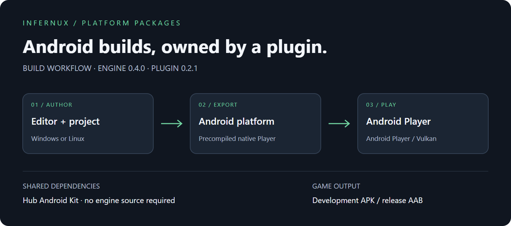

# Android Platform

Build Android Players for ARM64 devices and x64 emulators. The package owns target registration, precompiled native Players, SDL host files and APK/AAB export. Large reusable dependencies belong to the Hub's Android Platform Kit, not individual projects.

## Before building

Native debug information is maintained separately from the plugin; runtime libraries retain their dynamic symbols. No user-side stripping or compilation is required.

Install Infernux 0.4.2, Android compatibility in Hub, and the complete Android platform plugin. The plugin includes precompiled ARM64/x86_64 Player libraries and SDL Java host files. Normal APK/AAB exports do not require an engine source checkout, Git submodules, CMake, or host-side pybind11.

## Shared dependencies

Install or update the plugin directly from the editor's plugin manager. It downloads and imports the complete package automatically; installing a plugin does not require an Android toolchain.

Before exporting an APK/AAB, install **Android compatibility** in **Hub → Installations**. Hub manages the shared SDK, JDK, Gradle and Python runtimes and passes their locations to the editor, including custom Hub installations. These tools are installed once for all projects; do not download or configure them individually.

The current kit uses JDK 17, Gradle 8.12, Android API 36, build-tools 36.0.0, NDK 29.0.14206865 and both Android CPython 3.13 target runtimes. An emulator and AVD are separate from a physical-device build.

## Build and install

Select android-arm64 for a physical ARM64 device or android-x64-emulator for an x64 emulator. Development builds default to APK; release builds default to AAB. The Player requires Vulkan; there is no OpenGL ES fallback. The minimum application API is 26.

For a development APK, use `adb install -r path/to/game.apk`. Updating an installed game requires a compatible signing key. Do not uninstall an existing game just to hide a signature mismatch.

## Signing and storage

A release AAB remains unsigned unless signing is configured. Set INFERNUX_ANDROID_KEYSTORE, INFERNUX_ANDROID_KEY_ALIAS, INFERNUX_ANDROID_KEYSTORE_PASSWORD, and optionally INFERNUX_ANDROID_KEY_PASSWORD (defaults to the keystore password). Never commit passwords or keystores.

Gradle caches use Shared/Cache/Gradle under Hub, or the project's Cache/Gradle for standalone launches. Debug signing state uses Shared/State/Android or the project's State/Android. Clearing caches must not discard signing keys. Explicit GRADLE_USER_HOME and ANDROID_USER_HOME remain authoritative.

## Troubleshooting

Plugin installation and toolchain readiness are independent. Build diagnostics identify missing SDK, CPython, Gradle or Player files with their resolved paths. Manage shared build tools through Hub and use a complete platform plugin release compatible with the engine. Plugin installation and update failures are recorded in the editor Console.
